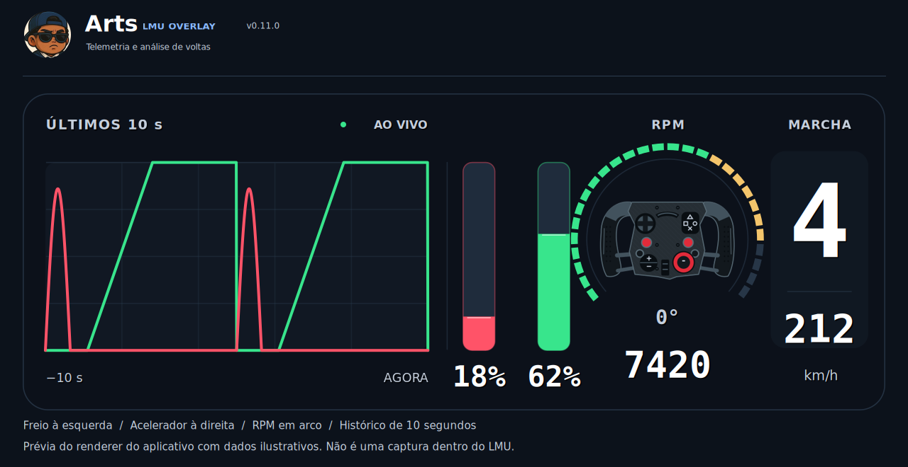
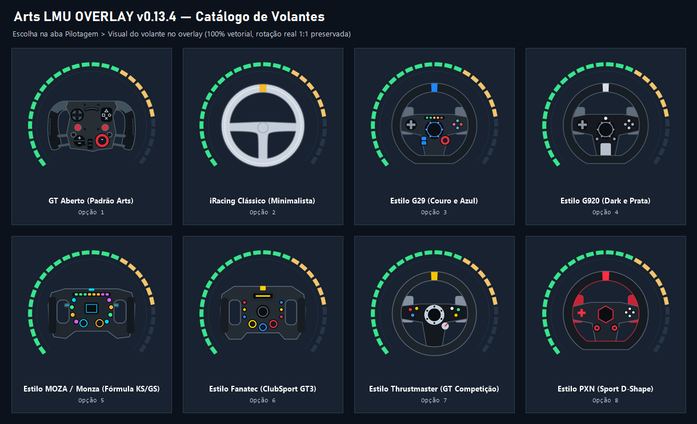

# Arts LMU OVERLAY 🏁

**Mais informação na pista. Mais clareza para evoluir a cada volta.**

O **Arts LMU OVERLAY** (`v0.13.4`) é um overlay e assistente de telemetria independente para **Le Mans Ultimate** no Windows, pensado para entregar leitura rápida durante a pilotagem, personalização individual por card e ferramentas práticas de evolução de ritmo.

### ⬇️ Download Direto (Somente o Instalador `.exe`)

Não é necessário baixar a pasta de código do projeto — clique abaixo para baixar apenas o instalador pronto para Windows x64:

👉 **[Baixar Instalar-Arts-LMU-Overlay-0.13.4.exe](https://github.com/DevArthurEvangelista/Arts-LMU-Overlay/releases/latest/download/Instalar-Arts-LMU-Overlay-0.13.4.exe)** *(ou acesse a [página de Releases](https://github.com/DevArthurEvangelista/Arts-LMU-Overlay/releases/latest))*

> **Nota do Windows ao instalar:** por ser um projeto independente sem certificado comercial pago, na primeira execução o Windows SmartScreen pode exibir *"O Windows protegeu o computador"*. Basta clicar em **Mais informações** → **Executar assim mesmo**.

> **Nota sobre imagens:** a prévia abaixo é gerada pelo próprio motor gráfico do aplicativo com **dados ilustrativos**. Ela demonstra o acabamento visual dos painéis, não uma captura de sessão real dentro do LMU.

---

## Principais Funcionalidades

- **Quadro de Classificação da Classe:** colunas fixas (`POS`, `+/−`, `GER`, `PILOTO / CARRO`, `ÚLTIMA`, `MELHOR`, `PNEU`, `GAP GER.` / `Δ SUA VOLTA`, `PEN.`, `BOX`), líder destacado, vizinhos de pista, bandeiras de nacionalidade, logos de fabricantes, compostos de pneus por cor e penalidades (`DT`, `SG` e tempo).
- **Pedais, Motor e Volante 1:1:** histórico dos **últimos 10 segundos** de freio e acelerador, barras verticais (freio à esquerda, acelerador à direita), arco circular de RPM com alerta visual de troca de marcha, marcha/limitador de box, velocidade, rotação real do volante físico via DirectInput e **8 estilos visuais de volante selecionáveis** (*GT Aberto*, *iRacing Clássico*, *G29*, *G920*, *MOZA*, *Fanatec*, *Thrustmaster* e *PXN*).
- **Delta Central Transparente (Espelho LMU):** barra horizontal limpa com espessura configurável (`6–28 px`) espelhando em tempo real o delta nativo do próprio LMU (`mDeltaBest`) na sessão, ou comparando contra sua melhor pessoal salva (por pista/carro/classe) e última volta válida.
- **Cards Opcionais Independentes:**
  - **Pneus e Danos:** temperatura superficial, pressão (`bar`), desgaste restante, avisos de pneu furado/roda solta e condição de suspensão (`SUSP.`) e aerodinâmica geral (`AERO`).
  - **Lap Timer:** volta atual, última, melhor, previsão estimada e voltas concluídas.
  - **Combustível:** volume no tanque, média por volta, autonomia estimada e cálculo para completar a sessão.
  - **Mapa da Pista:** traçado formado por coordenadas reais exibindo as posições da sua classe.
- **Módulo Aprendizado:** janela dedicada para revisar voltas válidas/inválidas da sessão e comparar setores oficiais (`S1`, `S2`, `S3`) e microsetores estimados (`100 m`, `200 m` ou `500 m`) no mapa — inclusive frente aos tempos setoriais de outros pilotos da sessão (sem capturar pedais de terceiros).
- **Treino por Trecho Offline *(Experimental)*:** integração supervisionada com o runtime oficial [Sector](https://github.com/sector-lmu/Sector) (`v1.0.0`) para salvar um ponto da pista (`F6`) e retornar a ele (`F7`) ou por botões vinculados do volante. **Funciona exclusivamente em treino offline iniciado sem Easy Anti-Cheat (EAC) em versão compatível do LMU.**
- **Chat por Voz Local com Whisper *(Experimental)*:** segure um botão do volante ou tecla vinculada na pista, fale e solte para transcrever localmente via `whisper.cpp` (sem nuvem) e enviar ao *Realtime Chat* do LMU, com indicador visual na tela.

---

## Atalhos Padrão

| Atalho | Ação | Contexto |
| :--- | :--- | :--- |
| `F8` *(configurável)* | Mostrar / ocultar todos os overlays | Na pista |
| `Ctrl + Alt + O` | Abrir painel de configurações | Global |
| `Ctrl + Alt + L` | Ativar / travar modo **Posicionar** | Global |
| `Esc` | Concluir posicionamento dos cards | Modo Posicionar |
| `F6` / `F7` *(ou botões do volante)* | Salvar ponto / Retornar ao ponto salvo | Somente Treino por Trecho offline conectado |

---

## Instalação e Requisitos

- **Sistema:** Windows 10/11 **64 bits** com **.NET Framework 4.8** (já incluso no Windows atualizado).
- **No Jogo:** configure o Le Mans Ultimate em modo **Janela sem bordas (*Borderless*)** para que os overlays apareçam sobre a tela.
- **Instalação rápida:** baixe o instalador `Instalar-Arts-LMU-Overlay-0.12.11.exe` na aba **Releases** (não requer privilégios de administrador e preserva todas as suas configurações anteriores).

Consulte os guias detalhados na pasta `docs/`:
- [Guia de Instalação e Compilação](docs/INSTALLATION.md)
- [Guia de Configuração e Uso](docs/CONFIGURATION.md)
- [Solução de Problemas (Troubleshooting)](docs/TROUBLESHOOTING.md)
- [Documentação Mestre do Projeto](docs/MASTER_PROJECT.md)
- [Histórico de Versões (Changelog)](CHANGELOG.md)
- [Manual Completo em Texto](LEIA-ME.txt)

---

## Status do Projeto e Compatibilidade

- **Versão atual:** `0.13.0` — código-fonte compilado em C# / `.NET Framework 4.8` com **616 verificações automatizadas** cobrindo parser binário, renderização GDI+, persistência, cálculo/espelho de delta, supervisão de protocolo Sector, catálogo de volantes e entrega de chat por voz.
- **Aviso importante:** testes automatizados validam a lógica interna, mas recursos dependentes de versão do LMU, endpoints locais (`127.0.0.1:6397`), DirectInput e foco de janela devem ser sempre validados em pista após atualizações do jogo.

---

## Créditos e Licenças de Terceiros

Os avisos e licenças dos componentes utilizados estão em [`third_party/`](third_party/):
- Leitura de memória compartilhada baseada no ecossistema rFactor 2 / LMU Shared Memory (MIT).
- [Sector](https://github.com/sector-lmu/Sector) `v1.0.0` empacotado sem modificações em `assets/SectorRuntime-1.0.0.zip` (MIT).
- [NAudio](https://github.com/naudio/NAudio) `2.2.1` para captura local de áudio (MIT) e integração opcional com [whisper.cpp](https://github.com/ggml-org/whisper.cpp) (MIT).
- Bandeiras [flag-icons](https://github.com/lipis/flag-icons) (MIT) e ícones automotivos [Simple Icons](https://simpleicons.org/) (CC0).

**Projeto independente.** Não é um produto oficial do Le Mans Ultimate nem possui vínculo com Studio 397 ou Motorsport Games. Nomes e marcas pertencem aos seus respectivos titulares.
