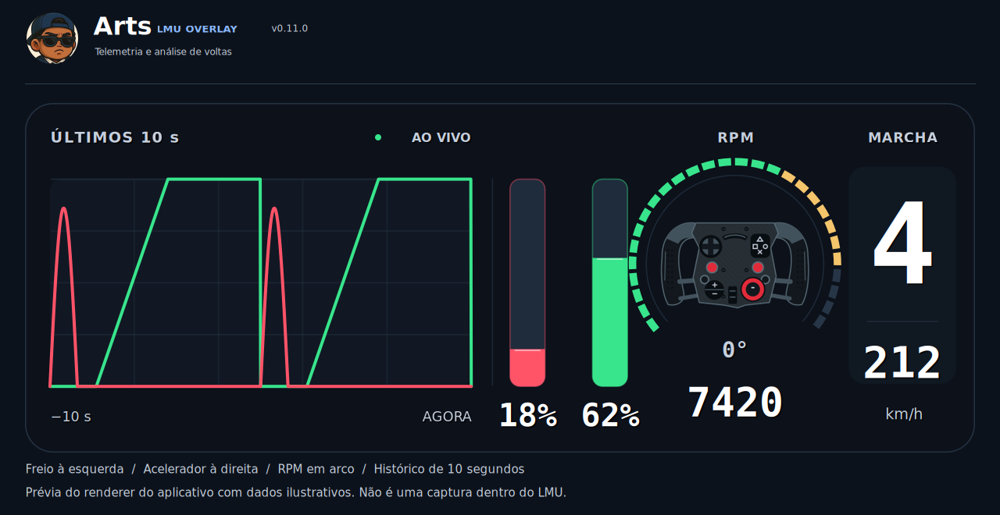

# Arts LMU OVERLAY 🏁

**Mais informação na pista. Mais clareza para evoluir a cada volta.**

O Arts LMU OVERLAY é um projeto independente para **Le Mans Ultimate**, criado por um piloto que queria enxergar melhor a corrida e entender onde poderia ganhar tempo. Os painéis aparecem sobre o jogo e reúnem classificação, pedais, volante, pneus, voltas e comparação de desempenho em uma interface que você pode organizar do seu jeito.

> As imagens desta página são prévias do aplicativo com **dados ilustrativos**. Elas mostram a aparência dos painéis, não uma captura de uma sessão real do LMU.

## A corrida, sem perder o contexto

A classificação destaca sua posição e mostra quem está perto de você, o líder da classe, tempos de volta, diferença, composto de pneu, paradas e penalidades. Em uma corrida multiclasse, a atenção fica na **sua classe**.

## Sinta o que o carro está fazendo

Acompanhe o uso do freio e do acelerador em um gráfico dos **últimos 10 segundos**. Ao lado, veja as barras dos pedais, marcha, velocidade, giro do motor e a representação do volante. O arco de RPM ajuda a perceber o momento da troca de marcha.

## Cuide da volta inteira

Os painéis opcionais ajudam a acompanhar pneus e danos, tempo de volta, combustível e o traçado da pista. Você escolhe o que quer deixar visível e ajusta posição, tamanho, fonte e transparência dos cards.

## Descubra onde está perdendo tempo

O **delta** mostra, durante a volta, se você está ganhando ou perdendo tempo em relação à referência escolhida. No módulo de aprendizado, você pode revisitar suas voltas e comparar setores e trechos no mapa para enxergar onde há espaço para melhorar.

No **treino por trecho**, você pode salvar um ponto e retornar a ele para repetir uma curva. Há opção de vincular botões do volante para salvar e retornar. Esse recurso é exclusivo do **treino offline compatível**, iniciado sem Easy Anti-Cheat; ele não funciona nas sessões online, classificação ou corrida. É uma integração experimental e depende da versão do jogo suportada.

## Feito para acompanhar sua pilotagem

- Funciona localmente no **Windows**, sem conta nem assinatura.
- Mostra os painéis durante a pilotagem e os oculta no menu e na garagem.
- Permite alternar a visibilidade com **F8**.
- Guarda suas preferências de posição e aparência.
- Reúne informações úteis para treino, classificação e corrida; o retorno a um ponto fica restrito ao treino offline compatível.

## Como experimentar

Este repositório contém o projeto. Se houver um instalador publicado na seção **Releases** deste GitHub, baixe a versão mais recente por lá. Depois, instale o app, abra o Le Mans Ultimate e organize os painéis na tela. As instruções detalhadas estão em [LEIA-ME.txt](LEIA-ME.txt).

**Projeto independente, em evolução.** Não é um produto oficial do Le Mans Ultimate nem possui vínculo com os criadores do jogo. Nomes e marcas de terceiros pertencem a seus respectivos titulares. Imagens de exemplo não representam telemetria de outros pilotos em sessões reais.
